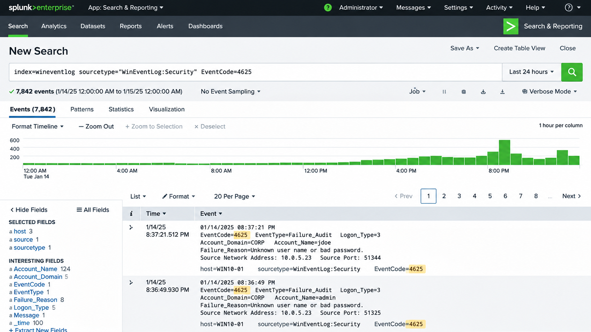

# Splunk SIEM Home SOC Lab

## Project Overview

This project documents my hands-on experience building and using a virtual Security Operations Center (SOC) laboratory to practice security monitoring, log analysis, and incident investigation.

The lab focuses on developing practical skills relevant to entry-level SOC Analyst and Cybersecurity Analyst positions.

## Lab Environment

**Technologies Used:**

* Splunk SIEM
* VirtualBox
* Windows
* Kali Linux
* Windows Event Viewer

**Environment:** Virtual cybersecurity laboratory.

## Project Objectives

* Practice collecting and analyzing Windows security logs.
* Understand how SIEM platforms support security monitoring.
* Investigate simulated suspicious activity.
* Identify potentially unusual authentication events.
* Practice documenting security observations and investigation findings.

## Activities Performed

### 1. SIEM Monitoring

Used Splunk to examine security events and practice identifying potentially suspicious activity.

### 2. Windows Event Log Analysis

Reviewed Windows security events and authentication-related activity to better understand how security analysts investigate events.

### 3. Security Alert Investigation

Practiced reviewing simulated security alerts and investigating unusual activity in a controlled environment.

### 4. Incident Documentation

Documented observations and practiced organizing findings to support security investigations.

## Cybersecurity Skills Demonstrated

* Security Information and Event Management (SIEM)
* Splunk
* Security Monitoring
* Windows Event Log Analysis
* Incident Investigation
* Security Event Analysis

## Lessons Learned

This lab strengthened my understanding of security monitoring, log analysis, and investigative workflows used in Security Operations Centers.

It also helped me connect my previous experience investigating AML alerts and documenting suspicious financial activity with cybersecurity alert investigation practices.

## Project Evidence

Screenshots of the Splunk environment, Windows Event Logs, and investigation findings can be added here as available.

All documented activities were performed in a controlled laboratory environment.

### Windows Failed Logon Analysis — Event ID 4625

Used Splunk Enterprise to examine Windows Security Event ID 4625,
which records failed authentication attempts.

The search returned 7,842 events over the selected 24-hour period.

Reviewed authentication failures, account names, timestamps,
source IP addresses, and unusual patterns of failed logon activity.

